<p align="center"></p>

Desenvolvo ferramentas que automatizam a edição de vídeo, da captura ao conteúdo pronto para publicar.

```python
inoval = {
    "foco": ["automação de vídeo", "visão computacional", "transcrição com IA"],
    "projeto_atual": "Clipador",
    "site": "https://inoval-dev.github.io",
}
```

## Projeto em destaque

<a href="https://inoval-dev.github.io"></a>

**[Clipador](https://inoval-dev.github.io)** acompanha lives, encontra os melhores momentos e entrega Shorts e vídeos longos editados, com timeline completa e agenda para o YouTube.

## Tecnologias


